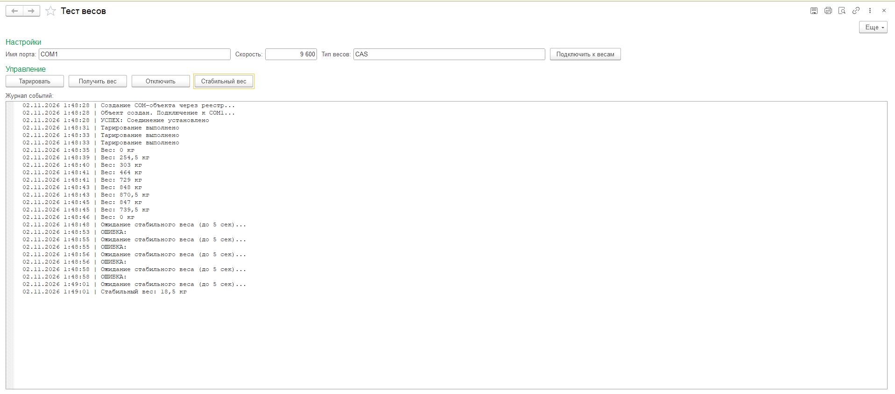

# 🔌 ScalesConnector — Обработка для 1С:Предприятие 8.3

Готовая обработка для подключения весов к 1С через COM-порт.

*На скриншоте: реальный тест обработки с весами CAS CI-200A. Видны процесс тарирования, колебания веса при загрузке, ожидание стабильного значения и итоговый результат 18,5 кг.*

## 📋 Возможности

- ✅ Автоматическое определение типа весов
- ✅ Получение стабильного веса с таймаутом
- ✅ Отображение текущего веса в реальном времени
- ✅ Логирование операций в журнале событий
- ✅ Поддержка 3 протестированных брендов (CAS, Massa-K, Metrisoft)

## 🚀 Установка

1. Скопируйте файл `ScalesConnector.epf` в любую папку
2. Откройте 1С:Предприятие в режиме **Конфигуратор**
3. Меню **Файл → Открыть** → выберите `ScalesConnector.epf`
4. Обработка откроется в режиме **Предприятие**

## 💻 Использование

### Быстрое взвешивание

1. Выберите COM-порт (например, `COM3`)
2. Укажите скорость (обычно `9600`)
3. Выберите тип весов (или оставьте `Auto` для автоопределения)
4. Нажмите **Подключиться**
5. Нажмите **Получить вес** или **Стабильный вес** — значение появится в журнале событий

### Тарирование

Нажмите кнопку **Тарировать** для обнуления веса тары. В журнале событий появится запись "Тарирование выполнено".

## ⚙️ Настройки COM-порта

| Параметр | Значение по умолчанию | Описание |
|----------|----------------------|----------|
| Имя порта | COM3 | Имя COM-порта (COM1, COM2, и т.д.) |
| Скорость | 9600 | Скорость передачи данных (бод) |
| Тип весов | Auto | Бренд весов или Auto для автоопределения |

## 🐛 Обработка ошибок

Если возникла ошибка подключения:

1. Проверьте, что весы включены и подключены к ПК
2. Убедитесь, что COM-порт не занят другим приложением
3. Проверьте настройки COM-порта (должны соответствовать весам)
4. Посмотрите текст ошибки в журнале событий

## ⚠️ Ограничения демо-версии

Данная обработка демонстрирует базовый функционал:
- Поддержка только 3 брендов (CAS CI-200A, Massa-K ТВ-М, Metrisoft)
- Ручной выбор COM-порта и скорости
- Нет сохранения истории взвешиваний
- Нет интеграции с документами 1С (накладные, приходные ордеры)
- Нет автоматического обновления
- Нет техподдержки

**Полная версия** доступна в коммерческой лицензии и включает:

- ✅ Все **3 протестированных бренда** с гарантией совместимости
- ⚠️ **12 брендов по документации** с возможностью доработки под вашу модель
- 🎯 Автоопределение весов без ручного выбора типа
- 📊 Расширенное логирование с сохранением в базу 1С
- 📄 Интеграция с документами (автоматическое заполнение веса в накладных)
- 🔄 Автоматическое обновление обработки
- 🛎️ Техподдержка (ответ в течение 4 часов)
- 🤝 Бесплатная доработка парсера под вашу конкретную модель в течение 30 дней

📧 **Для приобретения:** support@markpro-editor.ru  
💰 **Стоимость:** от 15 000 ₽

## 📞 Техподдержка

Если у вас возникли проблемы с подключением конкретных весов:
- Создайте Issue в репозитории с описанием проблемы и скриншотом журнала событий
- Или напишите на support@markpro-editor.ru