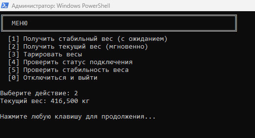

# 🖥️ Консольное приложение на C#

Пример использования библиотеки ScalesComponent в консольном приложении на C#.



## 📋 Требования

- .NET Framework 4.7.2 или выше
- Visual Studio 2019/2022 (или Rider)
- Зарегистрированная библиотека `ScalesComponent.dll`

## 🚀 Запуск

### Способ 1: Через Visual Studio

1. Откройте файл `ScalesComponent.slnx` в Visual Studio
2. В Solution Explorer найдите проект `ScalesComponent.Examples.ConsoleApp`
3. Нажмите правой кнопкой → **Set as Startup Project**
4. Нажмите **F5** для запуска

### Способ 2: Через командную строку

```cmd
cd Examples/CSharp/ConsoleApp
dotnet restore
dotnet run
```

## ⚙️ Настройка

Перед запуском измените параметры подключения в файле `Program.cs`:

```csharp
string portName = "COM3";      // Ваш COM-порт
int baudRate = 9600;           // Скорость передачи данных
string scalesType = "Auto";    // Тип весов (или конкретный бренд)
```

## 🎮 Использование

После запуска вы увидите меню с возможностями:

```
╔═══════════════════════════════════════════════════════════╗
║  МЕНЮ                                                     ║
╚═══════════════════════════════════════════════════════════╝
  [1] Получить стабильный вес (с ожиданием)
  [2] Получить текущий вес (мгновенно)
  [3] Тарировать весы
  [4] Проверить статус подключения
  [5] Проверить стабильность веса
  [0] Отключиться и выйти
```

## 🐛 Обработка ошибок

Если при подключении возникла ошибка, программа покажет подробное сообщение и рекомендации по устранению.

## 📚 Дополнительные ресурсы

- [API документация](../../../Docs/API.md)
- [Статус тестирования парсеров](../../../TESTING_STATUS.md)